# Edge Impulse — Treinamento do modelo

Projeto público: **https://studio.edgeimpulse.com/public/1142742/live**
(nome: `tinyml-carrinho-tpgn`)

## 1. Criação do projeto

Projeto pessoal e público, criado para classificar a distância medida pelo
HC-SR04 do carrinho em três classes: `longe`, `medio` e `perto`.

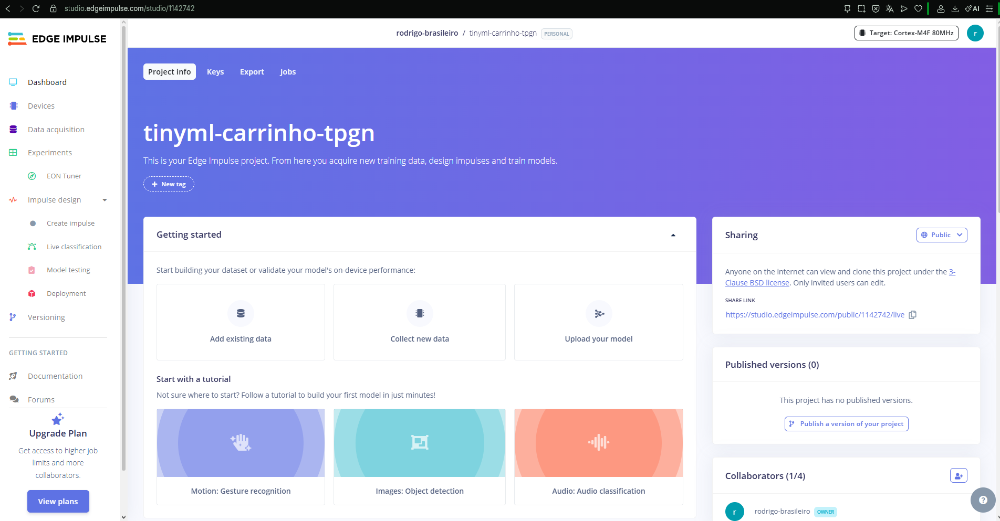

## 2. Preparação e importação dos dados

O arquivo [`../dados/dataset.csv`](../dados/dataset.csv) tem uma amostra por
linha (`distancia,label`). Para o Edge Impulse entender esse formato, foi
usado o **CSV Wizard** (Data acquisition → CSV Wizard):

- delimitador vírgula, com linha de cabeçalho;
- **não é série temporal** — cada linha é uma amostra;
- coluna de label: `label`;
- coluna de valores: `distancia`.

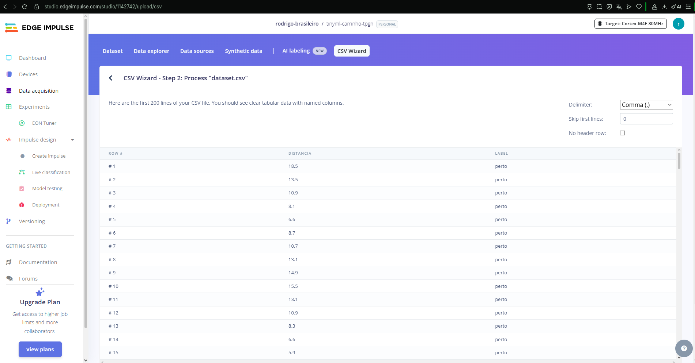
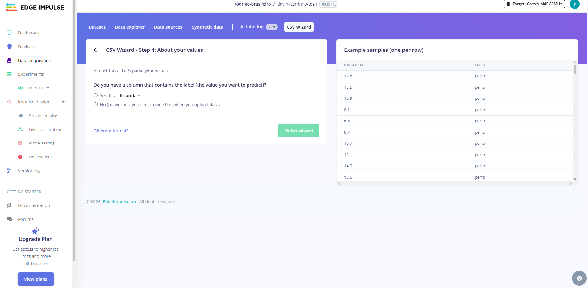


## 3. Divisão dos dados

Upload do `dataset.csv` com **Automatically split between training and
testing**. O Edge Impulse descartou as amostras idênticas (valores
repetidos enquanto o obstáculo estava parado) e ficaram **363 amostras**:

| Conjunto | Amostras |
| :--- | :---: |
| Treino (80%) | 291 — longe 115, medio 97, perto 79 |
| Teste (20%) | 72 |

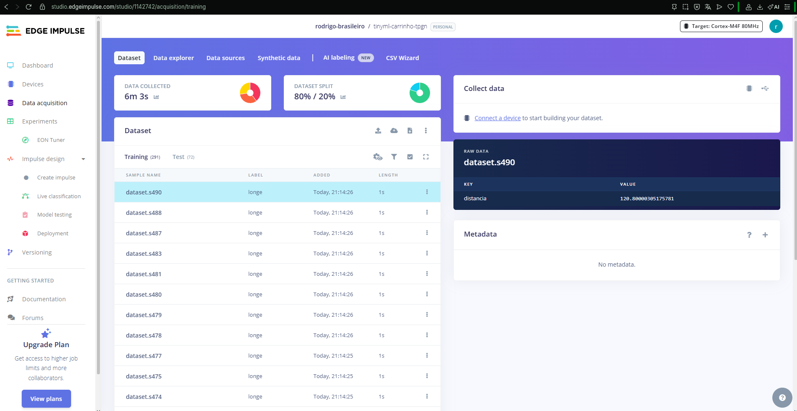

## 4. Configuração do Impulse

| Bloco | Configuração |
| :--- | :--- |
| Input features | `distancia` (100% dos dados) |
| Processing block | **Raw data** |
| Learning block | **Classification** |
| Output features | 3 classes: `longe`, `medio`, `perto` |

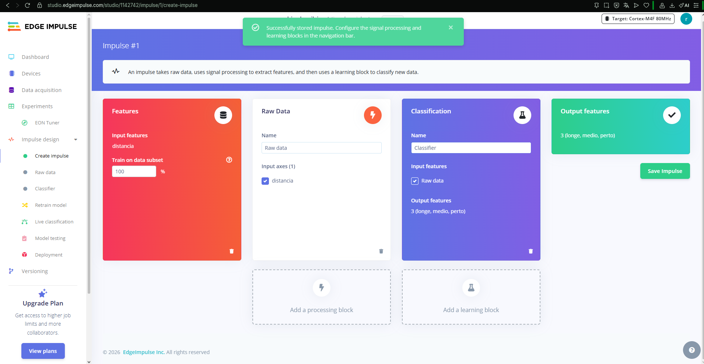

## 5. Processamento

Bloco **Raw data**: a distância (em cm, já filtrada pelo ESP32 com média
móvel e limitação de faixa) entra direto no modelo, sem transformação
adicional. Geração de features concluída para as 291 amostras de treino.

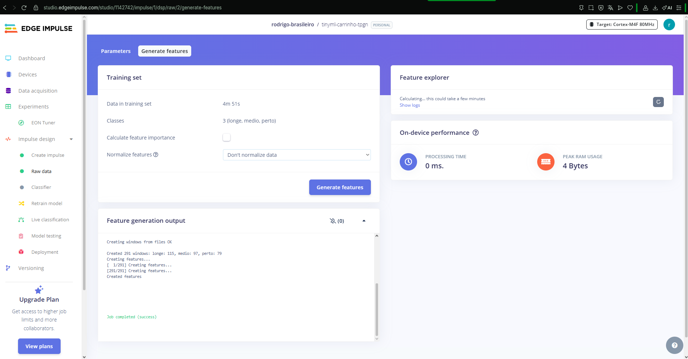

## 6. Modelo e treinamento

Rede neural densa (padrão do bloco Classification):

```
Input (1 feature) → Dense (20 neurônios) → Dense (10 neurônios) → Output (3 classes)
```

Learning rate: **0,005**. Processador de treino: CPU.

### Treino 1 — 20 ciclos

| Métrica (validação) | Valor |
| :--- | :--- |
| Acurácia | **86,4%** |
| Loss | 0,28 |
| F1 (longe / medio / perto) | 0,88 / 0,76 / 1,00 |

| Real ↓ / Previsto → | longe | medio | perto |
| :--- | :---: | :---: | :---: |
| longe | **100%** | 0% | 0% |
| medio | 38,1% | **61,9%** | 0% |
| perto | 0% | 0% | **100%** |

**Análise:** `perto` e `longe` foram classificados corretamente, mas 38,1%
das amostras de `medio` foram confundidas com `longe`. No Data explorer os
erros aparecem na ponta do grupo `medio` mais próxima de 50 cm, ou seja, o
modelo ainda não tinha aprendido onde fica a fronteira entre as duas classes.
Como os dados estavam bem separados, a hipótese foi treino insuficiente.

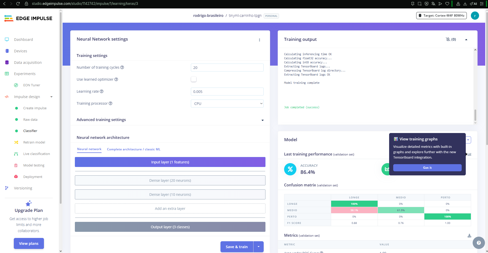
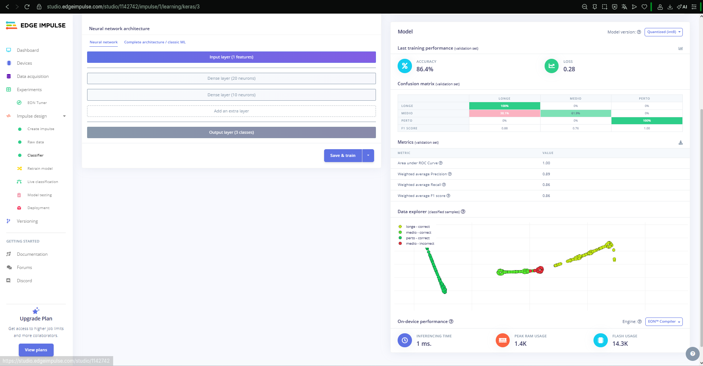

### Treino 2 — 100 ciclos

| Métrica (validação) | Valor |
| :--- | :--- |
| Acurácia | **100%** |
| Loss | 0,02 |
| F1 (longe / medio / perto) | 1,00 / 1,00 / 1,00 |
| Precision / Recall ponderados | 1,00 / 1,00 |

Com mais ciclos o modelo aprendeu as duas fronteiras (~20 cm e ~50 cm) e a
confusão entre `medio` e `longe` desapareceu.

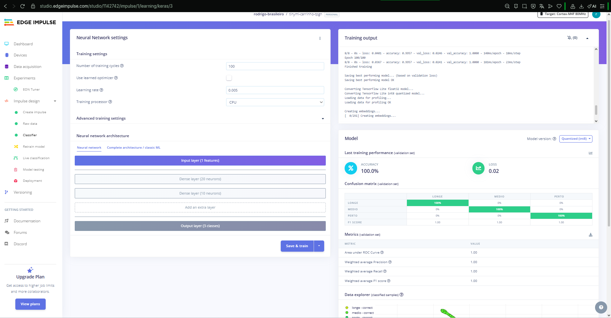
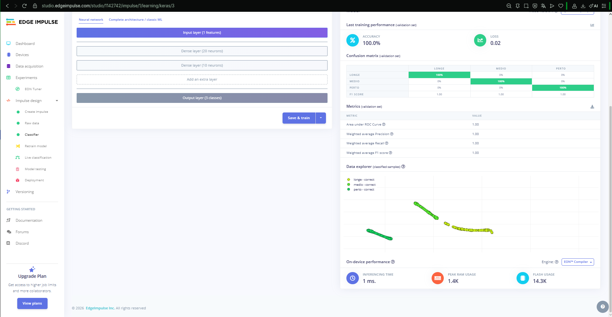

## 7. Testes de inferência

**Model testing → Classify all** com as 72 amostras de teste, que o modelo
não viu no treino:

| Versão do modelo | Acurácia | Uncertain |
| :--- | :---: | :---: |
| Unoptimized (float32) | **100%** | 0% |
| Quantized (int8) — versão embarcada | **100%** | 0% |

A quantização para int8 não reduziu a acurácia.

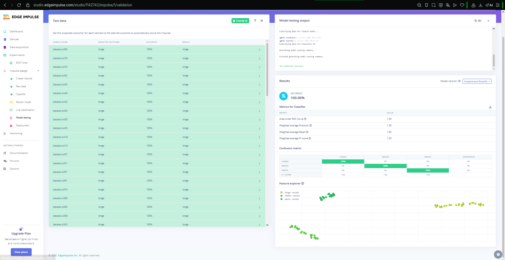
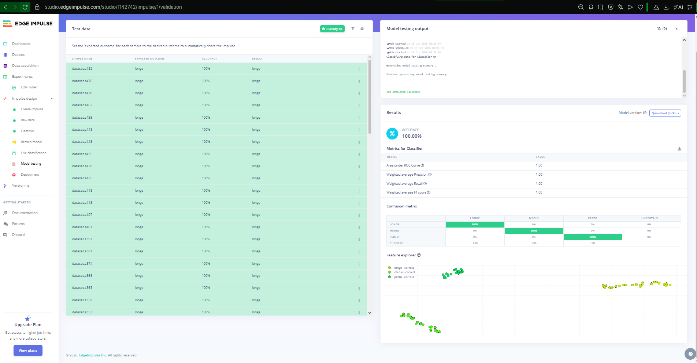

## 8. Exportação (Deployment)

- Target: **Arduino library**
- Inference engine: **EON Compiler**
- Otimização: **Quantized (int8)**
- Desempenho estimado: 1 ms de inferência, 1,4 KB de RAM, 14,3 KB de flash

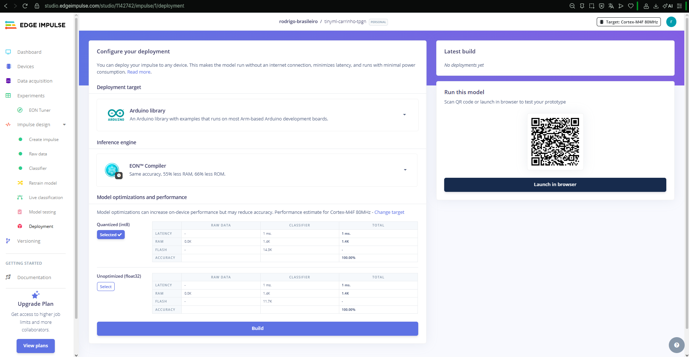

Biblioteca gerada: [`biblioteca/ei-tinyml-carrinho-tpgn-arduino-1.0.1.zip`](biblioteca/ei-tinyml-carrinho-tpgn-arduino-1.0.1.zip)
(header `tinyml-carrinho-tpgn_inferencing.h`), usada em
[`../src/tinyml_carrinho/tinyml_carrinho.ino`](../src/tinyml_carrinho/tinyml_carrinho.ino).
